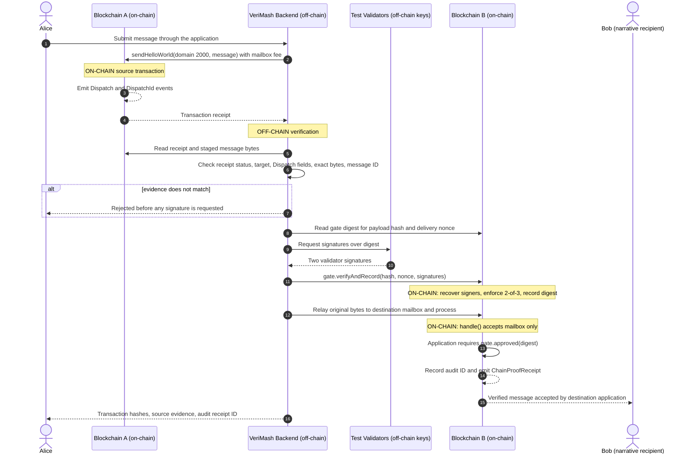
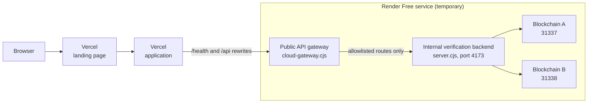

<div align="center">

<h1>VeriMash</h1>

<p><strong>Cross-chain message verification across two independent EVM blockchains</strong></p>

<p><em>Trust Shouldn't Be Assumed. It Should Be Verified.</em></p>

<p>Developed by <strong>Team Proto</strong></p>

<p>
  <a href="https://verimash.vercel.app/"><strong>Live Demo</strong></a>
  &nbsp;&nbsp;|&nbsp;&nbsp;
  <a href="https://github.com/Zeenat-25/verimash/tree/cloud-deployment"><strong>Source Code</strong></a>
  &nbsp;&nbsp;|&nbsp;&nbsp;
  <a href="#architecture"><strong>Architecture</strong></a>
  &nbsp;&nbsp;|&nbsp;&nbsp;
  <a href="#security-architecture"><strong>Security</strong></a>
  &nbsp;&nbsp;|&nbsp;&nbsp;
  <a href="#local-installation"><strong>Run Locally</strong></a>
</p>

<p>
A destination-chain smart contract refuses cross-chain messages unless two of three
authorized validators have signed them, and validators sign only after the backend has matched the
message to real source-chain transaction evidence. The source dispatch, destination approval, delivery, and receipt are recorded through actual test-chain transactions; source evidence checks and signature collection run off-chain.
</p>

</div>

<br/>

| Capability | What VeriMash does |
|---|---|
| **Two independent EVM chains** | Blockchain A (chain ID `31337`) and Blockchain B (chain ID `31338`) run as separate Hardhat nodes with separate state. |
| **On-chain execution** | Contracts are deployed to both chains. Dispatch, approval, delivery, and audit recording are real transactions, not an animation. |
| **2-of-3 validator approval, enforced on the destination** | `ChainProofValidatorGate` verifies signatures on Blockchain B. The destination application reverts unless the gate has recorded approval for that exact message. |
| **Source evidence verification** | The backend checks the source transaction receipt, the `Dispatch` event fields, the exact message bytes, and the `DispatchId` before any validator signs. |
| **Auditable receipts** | Each accepted message emits a `ChainProofReceipt` event with an audit ID and payload hash, readable in the Transaction Explorer. |
| **Security model** | Prototype with a **trusted relay**, locally controlled test validators, and temporary test networks. Not a production decentralized bridge. No real cryptocurrency moves. |

---

## Contents

[Problem](#the-problem) · [Architecture](#architecture) · [Transaction Flow](#transaction-flow) · [Security Architecture](#security-architecture) · [Application Walkthrough](#application-walkthrough) · [Smart Contracts](#smart-contract-architecture) · [Technology Stack](#technology-stack) · [Project Structure](#project-structure) · [Local Installation](#local-installation) · [Cloud Architecture](#live-cloud-architecture) · [Testing](#testing) · [Limitations](#current-limitations) · [Roadmap](#roadmap)

---

## The Problem

A blockchain cannot look inside another blockchain. When an application on Chain B receives a message that claims *"this happened on Chain A,"* it has to decide whether to believe it.

Alice sends Bob's application the message *"Invoice INV-2048 confirmed."* If the destination accepts messages without verification, an attacker can:

- **Forge** a message Alice never sent.
- **Alter** the invoice reference in transit.
- **Replay** Alice's real message to trigger the action twice.
- **Pass off** one approval, an unknown signer, or one signer counted twice as consensus.

Afterward there is no durable record connecting the outcome to a real source transaction.

> **How can independent blockchains communicate securely without blindly trusting cross-chain messages?**

VeriMash's answer is to check evidence at the source, require threshold approval, enforce that approval in a contract on the destination, and record an audit receipt.

---

## Architecture

The diagram follows the real implementation in `chainproof-dashboard/server.cjs`. Validator signatures are submitted to the gate on Blockchain B **before** the message is delivered, and the destination application consults the gate when the mailbox delivers the message.

```mermaid
flowchart LR
    subgraph A["ON-CHAIN: Blockchain A (chain ID 31337, domain 1000)"]
        direction TB
        APPA["Source application<br/>HelloWorld"]
        MBA["Source mailbox<br/>MockMailbox"]
        EVT["Dispatch + DispatchId events"]
        RCPT["Transaction receipt"]
        APPA --> MBA --> EVT --> RCPT
    end

    subgraph OFF["OFF-CHAIN: VeriMash verification service (Node.js)"]
        direction TB
        EV["1. Source evidence check<br/>receipt, event fields, block hash"]
        ID["2. Message identity check<br/>exact bytes, keccak256 = message ID"]
        SIG["3. Validator signature collection<br/>2 of 3 test accounts sign digest"]
        RLY["4. Trusted relay"]
        EV --> ID --> SIG --> RLY
    end

    subgraph B["ON-CHAIN: Blockchain B (chain ID 31338, domain 2000)"]
        direction TB
        GATE["Validator gate<br/>ChainProofValidatorGate<br/>verifies 2-of-3, records digest"]
        MBB["Destination mailbox<br/>MockMailbox"]
        APPB["Destination application<br/>HelloWorld requires approval"]
        AUD["Audit receipt<br/>ChainProofReceipt event"]
        MBB --> APPB --> AUD
    end

    RCPT -->|"fetched over RPC"| EV
    RLY -->|"a. submit signatures"| GATE
    RLY -->|"b. deliver original bytes"| MBB
    APPB -.->|"c. approved digest required"| GATE

    classDef onchain fill:#0f766e,stroke:#0b2545,color:#ffffff,stroke-width:1.5px
    classDef offchain fill:#e2e8f0,stroke:#0b2545,color:#0b2545,stroke-width:1.5px
    class APPA,MBA,EVT,RCPT,GATE,MBB,APPB,AUD onchain
    class EV,ID,SIG,RLY offchain
```



### Component responsibilities

| Component | Boundary | Responsibility |
|---|---|---|
| **Source application** (`HelloWorld`) | Chain A | Accepts `sendHelloWorld(domain, message)` and dispatches through the mailbox. |
| **Source mailbox** (`MockMailbox`, domain `1000`) | Chain A | Emits `Dispatch` and `DispatchId` events recorded in the transaction receipt. |
| **Staging mailbox** (`MockMailbox`, domain `2000`, deployed on Chain A) | Chain A | Holds the encoded message because `MockMailbox` needs a same-chain remote. This is where the backend reads the exact bytes to relay. |
| **Evidence and identity checks** | Off-chain | `verifySourceEvidence` confirms the receipt succeeded, targeted the source application, contains exactly one matching `Dispatch` event (sender, destination, recipient, bytes), and that `DispatchId` equals `keccak256(bytes)`. |
| **Validator signature collection** | Off-chain | Two of the three configured test validator accounts sign the gate's digest for this payload and delivery nonce. |
| **Trusted relay** | Off-chain | Submits signatures to the gate, then copies the original encoded bytes to the destination mailbox and triggers processing. |
| **Validator gate** (`ChainProofValidatorGate`) | Chain B | Recovers signers, enforces the threshold, rejects unauthorized or duplicate signers, and records the approved digest. |
| **Destination mailbox** (`MockMailbox`, domain `2000`) | Chain B | The only permitted caller of the destination application's `handle`. Rejects reprocessing. |
| **Destination application** (`HelloWorld`) | Chain B | In `_handle`, requires `gate.approved(digest)`, then records the audit receipt and emits events. |

---

## Transaction Flow

One message from dispatch to audit record. Bob is the **intended recipient in the demo narrative**: the verified message is accepted and recorded by the destination application contract. No cryptocurrency or tokens are sent to Bob's wallet.



---

## Security Architecture

VeriMash enforces four mechanisms. Each is covered by the automated test suite and can be triggered from the application's **Security Lab**. In each case, a rejected invalid attempt means the control worked.

| Security mechanism | Invalid attempt | Expected behavior |
|---|---|---|
| Replay Protection | Reuse an already delivered message | **Rejected** (`Mailbox: already delivered`) |
| Mailbox Authorization | Unauthorized message delivery | **Rejected** (`MailboxClient: sender not mailbox`) |
| Validator Approval | Only one valid signature | **Rejected** (`Gate: insufficient signatures`) |
| Source Evidence Integrity | Altered source message | **Rejected** (`Source Dispatch event does not match the staged message.`) |

### Replay Protection

**Attack prevented:** delivering the same genuine message twice to repeat its effect.

**How it is enforced:** the destination mailbox marks a message as processed and reverts any second attempt. The gate adds a second layer: approval is recorded per digest, and the digest includes the delivery nonce, so an approved digest cannot be recorded again (`Gate: already approved`).

**Security Lab evidence:** the test attempts to reprocess the first delivered message and displays that the replay was rejected with `Mailbox: already delivered`, and that no new audit receipt was recorded.

### Mailbox Authorization

**Why callers must be restricted:** if anyone could call the destination application's `handle` function, an attacker could fabricate a "bridged" message without any source transaction.

**How it is enforced:** the mailbox-client base contract that `HelloWorld` inherits limits `handle` to the configured mailbox.

**Security Lab evidence:** a different local account calls `handle` using `callStatic` (no transaction is broadcast). The lab confirms the revert reason `MailboxClient: sender not mailbox` and that the audit count did not change.

### Validator Approval Enforcement

Three test validator accounts are authorized on the gate with a threshold of two. `verifyAndRecord` reverts when:

| Condition | Revert reason |
|---|---|
| Fewer than two signatures supplied | `Gate: insufficient signatures` |
| Signer is not an authorized validator | `Gate: unauthorized signature` |
| The same validator signs twice | `Gate: duplicate validator` |
| Signature is malformed, high-`s`, or has a bad recovery ID | `Gate: invalid signature length`, `Gate: noncanonical signature`, `Gate: invalid recovery id` |
| Digest already approved | `Gate: already approved` |

The signed digest binds the source chain ID, destination chain ID, gate address, message hash, and nonce. The destination application then requires approval for the exact payload hash at its next delivery nonce, otherwise it reverts with `ChainProof: validator approval required`.

**Security Lab evidence:** one signature is rejected as insufficient; two valid signatures presented against an altered message hash are rejected as unauthorized.

### Source Evidence Integrity

Before any validator signs, the backend verifies against the source RPC:

1. The transaction receipt exists, succeeded, and targeted the configured source application.
2. Exactly one `Dispatch` event from the source mailbox matches the sender, destination domain, recipient, and exact encoded bytes.
3. A `DispatchId` event equals the `keccak256` hash of those bytes.
4. The receipt's block hash matches the chain's block.

**Security Lab evidence:** one extra byte is appended to the genuine encoded message and verification is rejected. The lab then re-verifies the original to show it still passes, and reports the source block.

> These controls are demonstrated on a local prototype with known test accounts. The contracts have **not** been professionally audited. The gate attests to a message digest and does not itself prove source-chain finality; source evidence is read through a trusted RPC, not a light client.

---

## Application Walkthrough

The application is at **[verimash.vercel.app](https://verimash.vercel.app/)**. The five sections below follow the intended order of use.

### 01 &nbsp; Live Transaction Demo

A guided Alice-to-Bob scenario. Alice and Bob are illustrative labels embedded in the message text (`Record type | Alice to Bob | reference | description`); the destination is the application contract on Chain B.

1. Enter a transaction reference, choose a record type, and describe the transaction.
2. Select **Send & verify transaction**.
3. Review the five stages: source dispatch, source evidence verification, 2-of-3 validator approval, relay to Chain B, destination delivery and audit.
4. Open the **verified delivery receipt**: source transaction hash, source block, message ID, approval, relay, and delivery hashes, audit receipt ID, and destination block.

Stages appear when the backend returns confirmed results; no block confirmations are simulated.

### 02 &nbsp; Transaction Workspace

Submit any message of 1 to 240 characters from Blockchain A to Blockchain B.

1. Type a message or choose an example.
2. Submit. The backend dispatches it on Chain A and verifies the source evidence.
3. Two validator signatures are verified by the gate on Chain B, then the message is relayed and delivered.
4. The five-stage journey fills in from the response.

<details>
<summary><strong>API response fields</strong></summary>

`POST /api/send` returns `dispatchTx`, `deliveryTx`, `relayTx`, `attestationTx`, `attestationDigest`, `auditId`, `payloadHash`, `validatorCount`, `feeWei`, `block`, and `sourceEvidence` (`sourceTx`, `sourceBlock`, `sourceBlockHash`, `messageId`, `confirmations`, `evidence`).

</details>

### 03 &nbsp; Security Lab

Four controlled negative tests: **replay**, **unauthorized caller**, **validator rejection**, and **source tampering**. Each returns the rejection reason and context. Most use read-only calls, so they demonstrate the contracts' checks without sending a new normal message. Replay, validator, and source-evidence tests need at least one delivered message first.

### 04 &nbsp; Transaction Explorer

A searchable table of the latest destination-chain audit receipts, read from the deployed contract: audit ID, message, route, destination transaction hash, block, and status. Opening a record shows the payload hash, sender, and destination delivery transaction. For the most recent transaction in the current browser session it also shows the source transaction, source block, source message ID, approval transaction, and relay transaction. A payload integrity tool compares candidate text against the on-chain payload hash without sending a transaction.

### 05 &nbsp; Overview Dashboard

Shows connection status for both chains, chain IDs, and three counters: messages dispatched on A, delivered on B, and verified audit receipts. It also summarizes what the demo proves and what it does not claim.

---

## Smart Contract Architecture

All contracts are in [`contracts/`](contracts) and compile with Solidity `0.8.22`.

| Contract | Path | Role |
|---|---|---|
| `HelloWorld` | `contracts/HelloWorld.sol` | One contract deployed twice: the **source application** on Chain A and the **destination application** on Chain B. On the destination, `_handle` enforces gate approval and writes audit receipts. |
| `MockMailbox` | `contracts/ChainProofMockImport.sol` (compiles the test mailbox) | Deployed three times: source mailbox (`1000`) and staging mailbox (`2000`) on Chain A, destination mailbox (`2000`) on Chain B. |
| `ChainProofValidatorGate` | `contracts/ChainProofValidatorGate.sol` | Destination-side threshold attestation. Deployed on Chain B with source chain `31337`, three validators, threshold `2`. |

<details>
<summary><strong>Where each check happens</strong></summary>

| Concern | Location |
|---|---|
| Signature recovery and validity (`ecrecover`, length, canonical `s`, recovery ID) | `ChainProofValidatorGate.verifyAndRecord` |
| Authorized validator list and duplicate-signer rejection | `ChainProofValidatorGate` (`isValidator`, in-call used-signer check) |
| Threshold (`2`) | `ChainProofValidatorGate` (`threshold`, immutable) |
| Digest binding to chains, gate address, payload hash, nonce | `ChainProofValidatorGate.getDigest` |
| Approval required before delivery | `HelloWorld._handle` calls `gate.getDigest` then `gate.approved` |
| Caller restriction on `handle` | Mailbox-client base contract (inherited by `HelloWorld`) |
| Message-level replay rejection | `MockMailbox` (`Mailbox: already delivered`) |
| Approval replay rejection | `ChainProofValidatorGate.approved` (`Gate: already approved`) |
| Audit storage | `HelloWorld`: `auditRecorded`, `totalAuditReceipts`, `ChainProofReceipt` event, `verifyAuditReceipt` |
| One-time gate configuration | `HelloWorld.setValidatorGate` (owner only, callable once) |

**Audit ID:** `keccak256(abi.encode(origin, sender, message, received))`, where `received` is the destination's delivery counter, which also serves as the approval nonce.

</details>

<details>
<summary><strong>What the trusted relay controls</strong></summary>

- Which source RPC receipts are treated as true (evidence is read through a trusted RPC, not a light client).
- The validator signing keys. In this prototype the backend holds the test accounts that sign.
- Submission of approvals to the gate and copying of the encoded bytes to the destination mailbox. `MockMailbox` allows the backend to add inbound messages directly.
- Ordering and timing of delivery.

The on-chain contracts independently enforce the threshold, signer authorization, nonce binding, caller restriction, and replay rejection. They do not remove trust in the relay.

</details>

---

## Technology Stack

Versions come from `package.json`, `hardhat.config.cts`, and `package-lock.json` on `cloud-deployment`.

| Technology | Version | Purpose |
|---|---|---|
| Solidity | `0.8.22` | Smart contracts (Hardhat compiler setting) |
| Hardhat | `^2.22.0` (locked `2.29.1`) | Compilation, local EVM nodes, test runner |
| Ethers.js | `5.8.0` | Contract calls, signing, receipt and event parsing |
| Messaging contract components | Used in the Solidity contracts | Message routing, mailbox access control, and test-network dispatch/delivery |
| Hardhat Ethers, Waffle, TypeChain (ethers-v5) | `2.2.3`, `^2.0.6`, `10.2.1` / `6.1.6` | Test and typing tooling |
| Mocha, Chai | `@types/mocha ^10.0.10`, `chai ^4.5.0` | Test framework and assertions |
| TypeScript, tsx | `^5.9.0`, `^4.20.0` | Test and Hardhat config execution |
| Node.js | `24.x` (`engines`) | Verification backend (built-in `http`), gateway, startup scripts |
| HTML, CSS, JavaScript | n/a | Static frontend with no build step |
| Vercel | n/a | Frontend hosting; rewrites `/api` and `/health` to the Render service |
| Render (Free) | n/a | Hosts the temporary chains, backend, and public gateway |

---

## Project Structure

```text
verimash/
├── contracts/
│   ├── ChainProofValidatorGate.sol    # 2-of-3 destination validator gate
│   ├── HelloWorld.sol                 # Source/destination application, audit receipts
│   └── ChainProofMockImport.sol       # Compiles the test mailbox used by the demo
├── chainproof-dashboard/
│   ├── server.cjs                     # Verification backend and API
│   ├── hardhat-chain-b.config.cts     # Hardhat config for Blockchain B (chain ID 31338)
│   ├── scripts/
│   │   └── deploy-dual.cjs            # Deploys contracts to both chains
│   └── public/                        # Frontend
│       ├── index.html, landing.css, landing.js
│       ├── app.html, app.js, style.css
│       ├── startup.css, startup.js    # Readiness screen
│       └── vercel.json                # Rewrites to the Render API
├── src/test/
│   └── chainproof-security-v7.test.ts # Security suite run by `npm test`
├── cloud-start.cjs                    # Hosted startup: chains, deploy, backend
├── cloud-gateway.cjs                  # Restricted public gateway
├── cloud-health.cjs                   # Minimal health-check server
├── hardhat.config.cts                 # Hardhat config for Blockchain A (chain ID 31337)
├── package.json
├── package-lock.json
└── tsconfig.json
```

`src/test/` also contains earlier test files that are not run by `npm test`. `node_modules/`, `artifacts/`, `cache/`, and `chainproof-dashboard/deployment.json` are generated and git-ignored.

---

## Local Installation

Commands target **Windows PowerShell**. Everything here is a local development workflow, separate from the Render deployment described [below](#live-cloud-architecture).

**Prerequisites:** [Git](https://git-scm.com/download/win), [Node.js 24.x](https://nodejs.org/), and internet access on the first compile (Hardhat downloads the Solidity compiler).

### 1. Clone and install

```powershell
git clone https://github.com/Zeenat-25/verimash.git
cd verimash
git checkout cloud-deployment
node --version     # expect v24.x
npm ci
npm run compile
```

### 2. Run the system in three terminals

Each of these is a long-running process that keeps its own terminal busy, so each needs its own PowerShell window. Open each one in the `verimash` folder.

**Terminal 1, Blockchain A** (chain ID `31337`, port `8545`):

```powershell
npx hardhat --config hardhat.config.cts node --hostname 127.0.0.1 --port 8545
```

**Terminal 2, Blockchain B** (chain ID `31338`, port `8546`):

```powershell
npx hardhat --config chainproof-dashboard/hardhat-chain-b.config.cts node --hostname 127.0.0.1 --port 8546
```

**Terminal 3, deploy, then start the backend** (once both chains are running):

```powershell
node chainproof-dashboard\scripts\deploy-dual.cjs
npm start
```

Deployment must finish before the backend starts, because the backend reads `chainproof-dashboard/deployment.json`. The Hardhat accounts are public development accounts. Never fund them or reuse them on a real network.

### 3. Try it

```powershell
Invoke-RestMethod http://127.0.0.1:4173/api/status

Invoke-RestMethod -Method Post -Uri http://127.0.0.1:4173/api/send `
  -ContentType "application/json" -Body '{"message":"Hello from Chain A"}'

Invoke-RestMethod -Method Post -Uri http://127.0.0.1:4173/api/replay `
  -ContentType "application/json" -Body '{}'
```

> On this branch the local server serves only `index.html`, `style.css`, and `app.js`. The complete multi-page interface is delivered by the hosted site, so locally use the API above or the [live application](https://verimash.vercel.app/).

### 4. Run the security tests

```powershell
npm test
```

This uses Hardhat's in-process network and does not need Terminals 1 to 3.

<details>
<summary><strong>Troubleshooting</strong></summary>

| Problem | Fix |
|---|---|
| `Cannot find module` | Run `npm ci` in the repository root. |
| `HH502` compiler download error | Connect to the internet and rerun `npm run compile`. |
| `EADDRINUSE` on 8545, 8546, or 4173 | Find the owner with `Get-NetTCPConnection -LocalPort 8545`, stop it with `Stop-Process -Id <PID>`. For the backend, set `$env:PORT=4174` first. |
| Backend exits with `Missing deployment.json or compiled artifacts` | Run `npm run compile`, confirm both chains are up, run `deploy-dual.cjs`. (The message names `scripts/deploy.cjs`; the real script is `deploy-dual.cjs`.) |
| `Two independent local networks need distinct chain IDs` | Start Chain B with `chainproof-dashboard/hardhat-chain-b.config.cts`. |
| `Contracts not found` or chain ID changed | A node was restarted and lost state. Redeploy, then restart `npm start`. |
| Config loading errors | Set `$env:NODE_OPTIONS="--import tsx/esm"` and retry (the option `cloud-start.cjs` uses). |
| `A transaction is currently being processed` | The backend handles one request at a time. Retry. |

</details>

---

## Live Cloud Architecture



- **Vercel** serves the static landing page and application. Its `vercel.json` rewrites `/health` and `/api/*` to the Render service.
- **`cloud-start.cjs`** (the hosted entry point) starts both Hardhat chains, waits for the expected chain IDs, deploys contracts, starts the backend on internal port `4173`, and reports its progress to the gateway.
- **The gateway** listens on Render's public port and exposes only `GET /health`, `GET /api/status`, and six `POST` API routes. It caps request bodies at 1 KB, rate-limits each route per client, and exposes neither raw JSON-RPC nor other internal paths.
- **Cold starts:** the site can load while Render is asleep or waking. The application's startup screen polls `/health` and `/api/status`, and enables the demo only when both chains report the expected IDs (`31337` and `31338`). If it takes too long, a retry button appears.
- **Temporary state:** the chains run inside the Render service. Blockchain history resets whenever the service sleeps or restarts. There is no 24/7 availability or persistent history.

---

## Testing

```powershell
npm test
```

Runs `src/test/chainproof-security-v7.test.ts` on Hardhat's in-process network. It deploys source and destination mailboxes, applications, and the 2-of-3 gate for each test.

| # | Test | Covers |
|---|---|---|
| 1 | Delivered message without approval | Destination reverts; no receipt |
| 2 | One validator signature | `Gate: insufficient signatures` |
| 3 | Forged signature from an unauthorized account | `Gate: unauthorized signature` |
| 4 | Duplicate signatures from one validator | `Gate: duplicate validator` |
| 5 | Approval signed for different content | Real message still blocked |
| 6 | Direct `handle` call by a non-mailbox account | `MailboxClient: sender not mailbox` |
| 7 | Authorized delivery once, then replay and duplicate approval | Accepted once; `Mailbox: already delivered`; `Gate: already approved` |
| 8 | Real source `Dispatch` evidence and modified bytes | Event and `DispatchId` match; altered bytes do not |

Three kinds of validation are separate: **compilation and deployment** (Solidity builds and contracts deploy), **runtime status** (`/health` and `/api/status` report both chains ready), and **security testing** (this suite and the Security Lab). One does not imply the others. This README states no fixed pass count and no CI status; the repository defines no CI workflow.

---

## Current Limitations

VeriMash is a prototype, and its trust assumptions are part of its design.

- **Temporary independent EVM test networks.** The chains are disposable Hardhat nodes.
- **Trusted local relay.** The relay reads source evidence through a trusted RPC and moves messages between chains.
- **Locally configured test validators.** Validator accounts are Hardhat development accounts, and the backend produces their signatures. This demonstrates on-chain threshold enforcement, not independent validator operators.
- **No real asset movement.** Messages are verified and delivered. No cryptocurrency or tokens are transferred, and no public mainnet is used.
- **Render Free behavior.** The service may sleep when idle, and restarts recreate chain state. Records are not guaranteed to persist.
- **Mock messaging infrastructure.** `MockMailbox` is a test mailbox implementation, not a production cross-chain messaging network.
- **No independently decentralized verification.** Further security review and auditing are required before any production use.

Even so, the prototype provides meaningful technical verification. Real transactions execute on separate chains, evidence is matched against actual receipts and events, and the destination contract refuses unapproved messages independently of what the relay claims.

---

## Roadmap

All items are **planned, not implemented**.

| Area | Planned work |
|---|---|
| Networks | Public EVM testnet support |
| Validators | Independently operated validators |
| Relay | Improved relayer reliability and fault tolerance |
| Records | Persistent audit indexing and history |
| Operations | Better infrastructure monitoring |
| Assurance | Security review and formal auditing |
| Deployment | Production hardening |

---

<div align="center">

**Built by Team Proto**

*Different chains. One standard of trust. Verify before you accept.*

**[Open the Live Demo](https://verimash.vercel.app/)**

</div>
